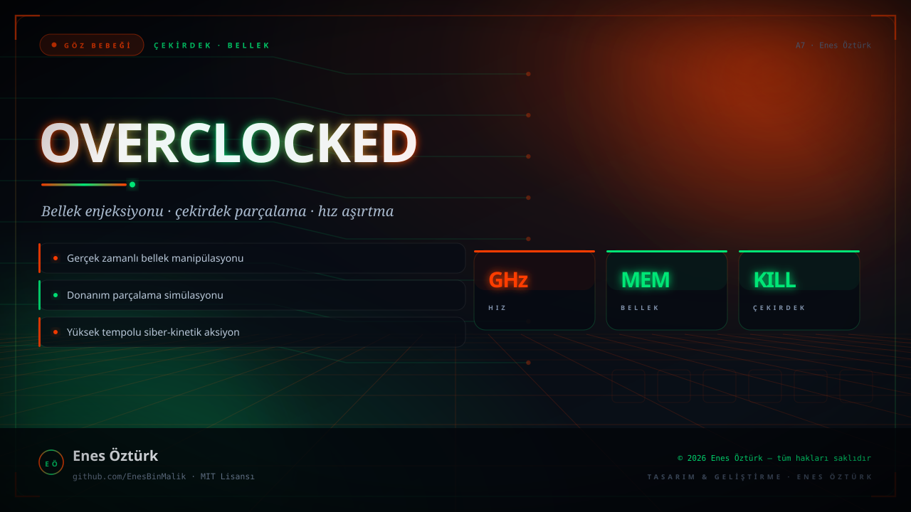
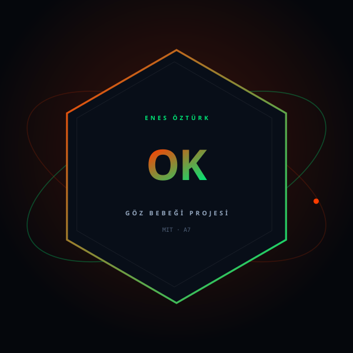

<div align="center">





# OVERCLOCKED: KERNEL SLAYER

**Çekirdeğe in. Belleği enjekte et. Donanımı parçala. Hız sınırı yok.**

[](https://github.com/EnesBinMalik)
[](LICENSE)
[](https://github.com/EnesBinMalik)

<sub>ÇEKİRDEK · BELLEK · SİBER-KİNETİK</sub>

</div>

---

## Bu proje nedir?

Çekirdeğe in. Belleği enjekte et. Donanımı parçala. Hız sınırı yok.

**GÖZ BEBEĞİ** etiketiyle yayınlanmıştır: tasarımı, mimarîsi ve her satırı **Enes Öztürk** tarafından yazılmıştır.

## Öne çıkanlar

- **Gerçek zamanlı bellek manipülasyonu** — çalışan bir sürecin belleğine yazarsın; sonuç anında dünyaya yansır.
- **Donanım parçalama** — hız aşırtma seni güçlendirir, ama çipi de yakar; dengeyi sen kurarsın.
- **Çekirdek savaşı** — düşmanlar çekirdek seviyesinde çalışır, onları orada yenmelisin.
- **Yüksek tempolu siber-kinetik aksiyon** — her milisaniye bir karar.

## Teknoloji

`Three.js` · `TypeScript` · `Vite` · `WebGL shaders` · `Memory injection sim` · `Kernel-level combat`

## Kurulum

```bash
npm install
npm run dev
```

## Lisans

**MIT Lisansı** — bkz. [LICENSE](LICENSE)

---

<div align="center">
<sub>© 2026 Enes Öztürk — tüm hakları saklıdır · <a href="https://github.com/EnesBinMalik">Çekirdeği parçala · github.com/EnesBinMalik</a></sub>
</div>
